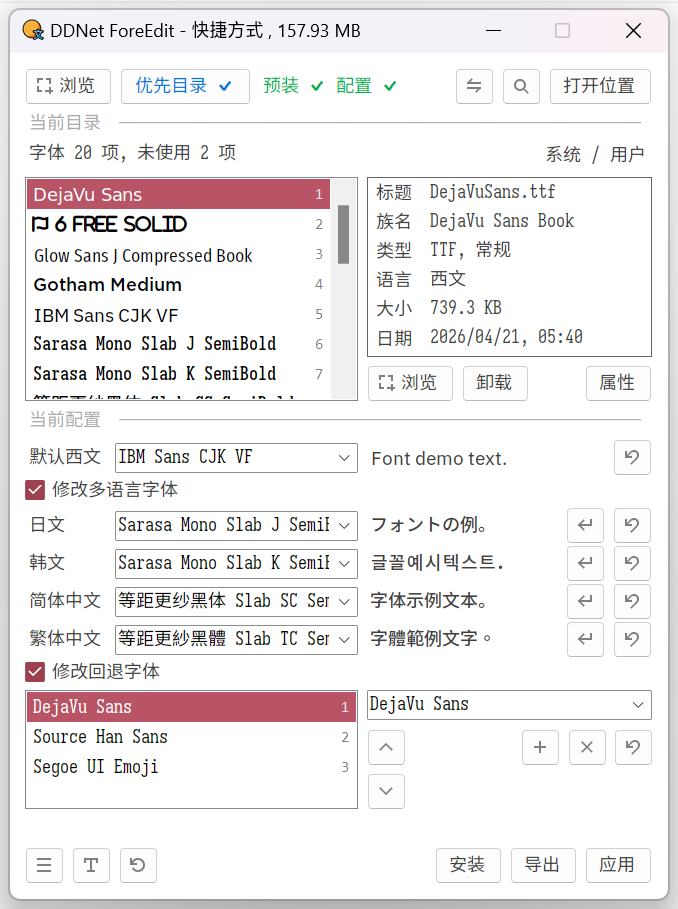
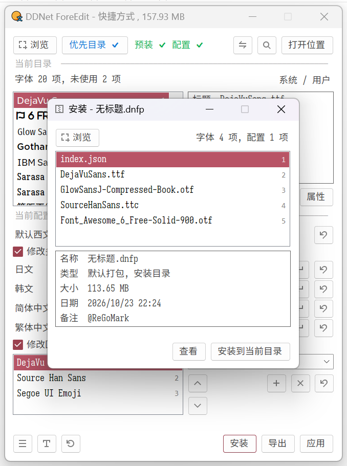
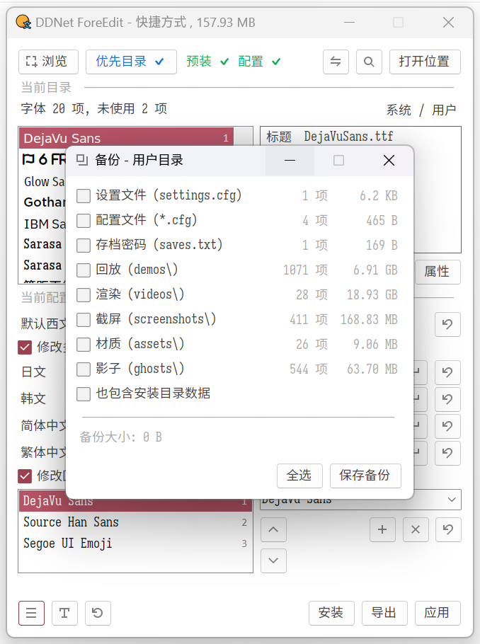
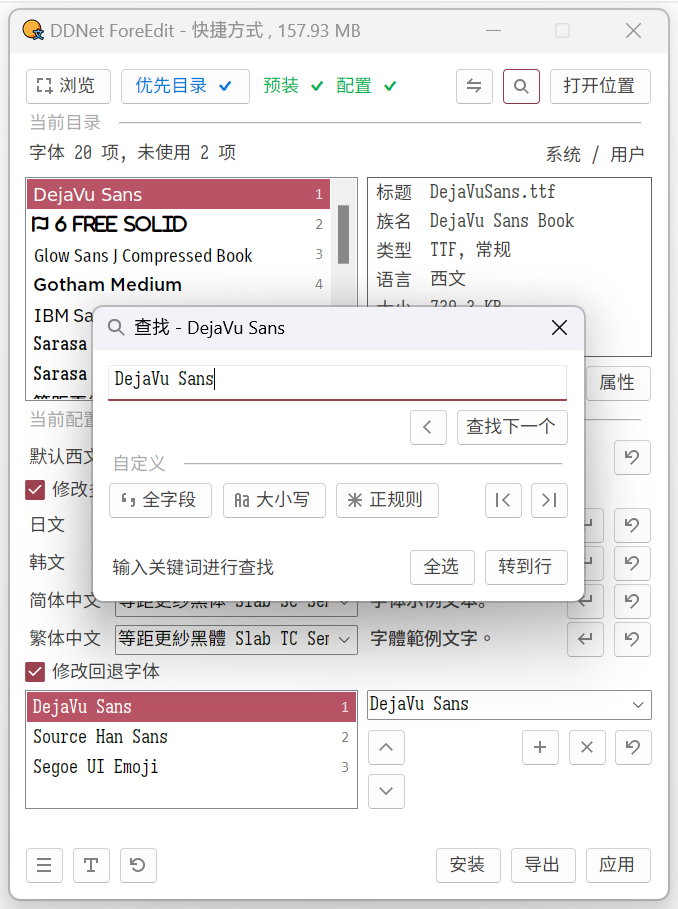
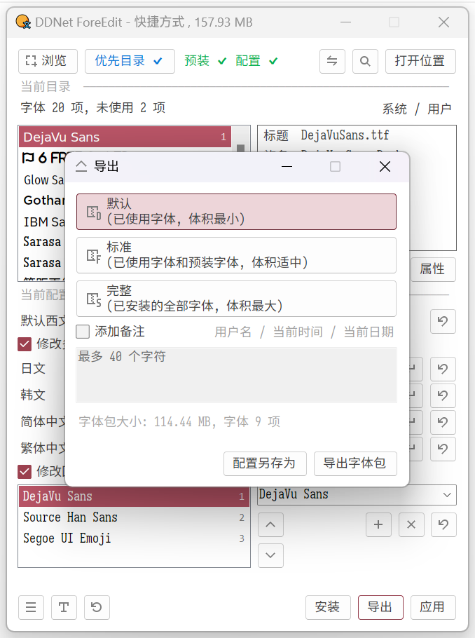
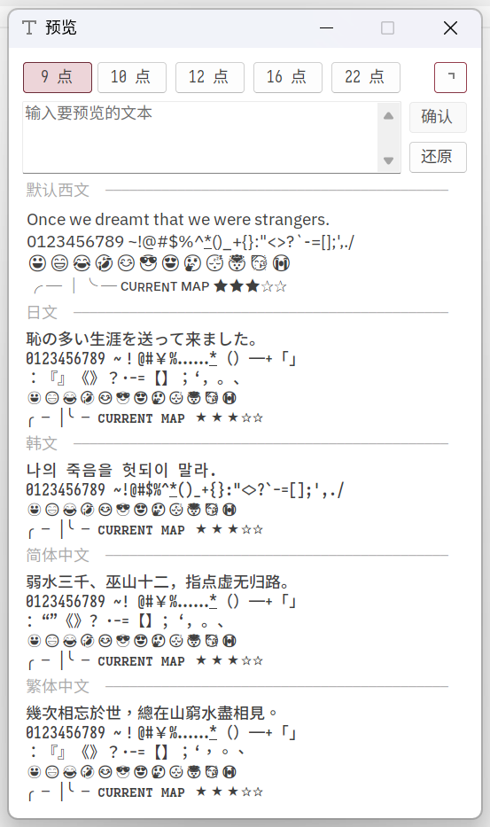

# DDNet ForeEdit

**DDNet 字体管理与配置编辑工具**

DDNet ForeEdit 是一款面向 DDNet 的字体管理工具，旨在简化游戏字体的安装、管理与配置过程。通过图形化界面，用户可以管理字体文件、修改默认字体及多语言字体配置、调整字体回退顺序，并通过字体包实现配置与字体资源的分享和迁移。

## 功能特性

### 字体管理
- **字体安装**：支持 `.TTC`、`.TTF`、`.OTF` 格式，支持批量导入。
- **字体卸载**：支持批量卸载第三方字体。
- **字体属性**：查看字体文件名、字体家族、扩展名、字重、字宽、斜体属性、支持语言、文件大小及修改日期等信息。
- **未使用字体检查**：检查当前未被配置使用的字体，方便整理字体目录。
- **预装字体验证**：检查程序预装字体是否完整，并提供相应的修复功能。

### 字体配置
- **默认字体**：修改游戏默认使用的字体，并实时预览显示效果。
- **多语言字体**：为日语、韩语、简体中文和繁体中文等语言指定独立字体。
- **回退字体**：管理字体回退列表，调整字体顺序，以改善特殊字符、表情符号等内容的显示效果。
- **配置验证**：检查 `index.json` 配置文件及其字体引用状态。

### 字体包与配置迁移
- **配置保存**：保存当前字体配置修改。
- **字体包导出**：将字体资源与配置打包为 `.dnfp` 文件，方便分享与迁移。
- **配置导出**：单独导出 `index.json` 配置文件。
- **字体包安装**：导入字体包或配置文件，并在确认操作前查看相关字体的安装、覆盖及删除情况。
- **恢复默认**：支持仅恢复默认配置，或同时恢复预装字体与默认配置。
- 
### 预览与辅助功能
- **字体预览**：自定义预览文本、调整预览字号，查看字体的实际显示效果。
- **拖放操作**：通过拖入 DDNet 快捷方式、`DDNet.exe` 或 `index.json` 快速定位字体目录；支持拖入字体文件进行批量导入。
- **目录切换**：支持在不同字体目录之间切换。
- **数据备份**：按需备份游戏设置、配置文件、存档密码、渲染视频及材质资源。

## 界面预览

<table>
  <tr>
    <td>
      
       主界面
    </td>
    <td>
      
       字体包/配置安装
    </td>
  </tr>
  <tr>
    <td>
      
       游戏数据备份
    </td>
    <td>
      
       字体查找
    </td>
  </tr>
  <tr>
    <td>
      
       字体包/配置导出
    </td>
    <td>
      
       字体预览
    </td>
  </tr>
</table>

## 使用指南

📕 [说明文档](./Data/library.pdf)

### 1. 加载字体目录

启动程序后，可以通过以下任一方式加载 DDNet 字体目录：

- 拖入 DDNet 快捷方式。
- 拖入 `DDNet.exe`。
- 拖入 `index.json`。
- 通过浏览功能手动选择相应文件。

DDNet 字体可能位于游戏安装目录或用户目录中。用户目录又分为 DDNet 和 Teeworlds 两种目录；当两者同时存在时，DDNet 用户目录优先。可以使用目录切换功能选择需要管理的位置。

### 2. 管理字体

在字体列表中，可以浏览字体、查看属性、预览字体以及安装或卸载字体。双击字体条目即可预览，右键菜单提供更多操作。

### 3. 修改字体配置

在配置区域中选择默认字体，即可修改游戏的默认字体。通常只修改默认字体就能实现全局效果；如果需要不同语言使用不同字体，可以启用多语言字体设置。

如果游戏中出现字符显示异常或表情无法正常显示，可以尝试调整回退字体列表及其顺序。

### 4. 保存、导出与恢复

- **保存**：保存当前配置修改。
- **导出字体包**：生成 `.dnfp` 文件，可选择不同的打包模式。
- **导出配置**：单独保存 `index.json`。
- **安装字体包**：选择 `.dnfp` 文件或 `index.json`，检查操作内容后确认安装。
- **恢复默认**：根据需要恢复默认配置，或同时恢复预装字体。

> 注意：字体卸载、字体包安装以及部分预装字体修复或恢复操作可能需要重新启动程序。

## 字体包导出模式

| 模式 | 包含内容 |
| --- | --- |
| 默认 | 仅包含配置文件中使用的字体 |
| 标准 | 配置文件使用的字体，以及预装字体 |
| 完整 | 当前字体目录下的全部字体 |

导出时还可以为字体包添加备注，备注最多 40 个字符。

## 快捷键参考

### 主窗口

| 操作 | 快捷键 |
| --- | --- |
| 浏览文件 | `Ctrl + O` |
| 用户目录 | `Ctrl + U` |
| 预装字体验证 | `Ctrl + Shift + V` |
| 编辑配置文件 | `Ctrl + Shift + J` |
| 刷新 | `F5` |
| 查找 | `Ctrl + F` |
| 打开文件位置 | `Ctrl + L` |
| 预览工具 | `Ctrl + P` |
| 恢复默认 | `F8` |
| 安装字体包或配置 | `Ctrl + B` |
| 导出字体包或配置 | `Ctrl + J` |
| 应用配置 | `Ctrl + S` |

**快捷操作：**
- 按住 `Shift` 再点击「打开文件位置」，复制路径。
- 按住 `Shift` 再点击「应用」，应用配置后启动游戏。

### 字体列表

| 操作 | 快捷键 |
| --- | --- |
| 浏览字体文件 | `Ctrl + I` |
| 卸载字体 | `Delete` |
| 查看字体属性 | `Alt + Enter` |
| 复制字体家族名称 | `Ctrl + Shift + F` |
| 复制字体名称 | `Ctrl + Shift + N` |
| 未使用字体检查 | `Ctrl + Shift + U` |

### 预览窗口

| 操作 | 快捷键 |
| --- | --- |
| 确认预览文本 | `Enter` |
| 还原默认预览文本 | `Ctrl + R` |

### 查找窗口

| 操作 | 快捷键 |
| --- | --- |
| 查找上一个 | `Shift + F3` |
| 查找下一个 | `F3` / `Enter` |
| 跳转到首个匹配项 | `F2` |
| 跳转到末尾匹配项 | `F4` |
| 转到指定行 | `Ctrl + G` |

## 联络

📺︎ [哔哩哔哩](https://space.bilibili.com/220248940?spm_id_from=333.1007.0.0)

📩 regmvks@outlook.com

## 赞助

